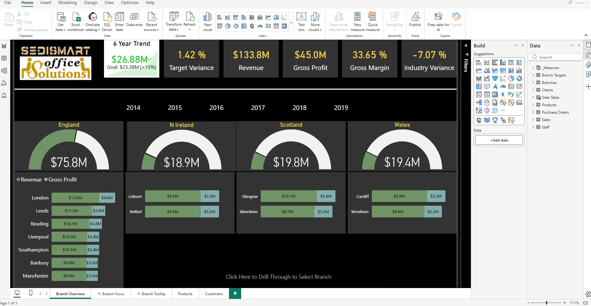

# Power BI UK Sales Report


## Project Overview

This interactive Power BI report analyzes the sales and profitability performance of a fictional office supplies business operating across the United Kingdom.

The report provides an executive overview of revenue, gross profit, gross margin, target performance, regional results, branch performance, products, and customers. It also includes interactive navigation, drill-through functionality, and report page tooltips.

> **Project attribution:** This is a guided portfolio project completed as part of the Udemy course *Microsoft Power BI Online Training: Comprehensive Course on Power BI and the DA-100/PL-300 Exam*. The dataset and original project requirements were provided for educational purposes.

## Dashboard Preview




## Business Questions

The report was designed to answer the following questions:

- How has revenue changed over the six-year reporting period?
- Is the business meeting its sales targets?
- Which countries, regions, and branches generate the most revenue?
- What are the total gross profit and gross margin?
- How does performance vary across England, Northern Ireland, Scotland, and Wales?
- Which products and customers contribute the most to sales?
- Which branches require additional analysis through drill-through navigation?

## Key Metrics

Based on the complete report view:

| Metric | Result |
|---|---:|
| Revenue | $133.8M |
| Gross Profit | $45.0M |
| Gross Margin | 33.65% |
| Target Variance | 1.42% |
| Industry Variance | -7.07% |
| Six-Year Trend | $26.88M |

> The values above come from the educational dataset and do not represent the financial performance of a real company.

## Report Pages

1. **Branch Overview**: Executive KPIs, six-year trend, regional performance, and branch comparisons.
2. **Branch Focus**: Detailed analysis of an individual branch.
3. **Branch Tooltip**: Contextual information displayed through a report page tooltip.
4. **Products**: Product-level sales and profitability analysis.
5. **Customers**: Customer-level performance analysis.

## Power BI Features Demonstrated

- Data import and transformation with Power Query
- Data cleaning and preparation
- Relational data modeling
- Dedicated date table
- DAX measures and calculated metrics
- KPI cards and gauge charts
- Revenue and gross profit comparisons
- Interactive filters and report navigation
- Drill-through analysis
- Report page tooltips
- Branch-, country-, product-, and customer-level analysis
- Power BI Project (`.pbip`) format for Git version control

## Repository Structure

```text
Power-BI-UK-Sales-Report/
├── Sales Report.Report/          # Power BI report definition
├── Sales Report.SemanticModel/   # Semantic model, relationships, and DAX
├── Sales Report.pbip             # Power BI project file
├── Docs/                         # Supporting documentation
├── Screenshots/                  # Dashboard preview images
├── .gitignore
└── README.md
```

## How to Open the Project

1. Download or clone this repository.
2. Install Microsoft Power BI Desktop.
3. Open `Sales Report.pbip` from the root folder.
4. Power BI Desktop will load the report and its semantic model.

To clone the repository with Git:

```bash
git clone https://github.com/FedericoGuillen/Power-BI-UK-Sales-Report.git
```

## Tools Used

- Microsoft Power BI Desktop
- Power Query
- DAX
- Git
- GitHub

## Learning Outcomes

Through this project, I practiced the complete Power BI reporting workflow: importing and transforming data, building a semantic model, creating DAX measures, designing interactive report pages, and documenting the solution for version control and portfolio presentation.

## Attribution and Usage

This repository is published for educational and portfolio purposes. The project was developed by following a guided Udemy course. Course materials, source files, and branding remain the property of their respective owners.

## Author

**Federico Nicolás Guillen D'Auri**

